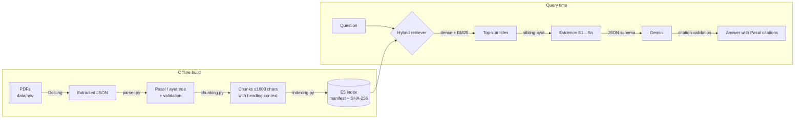

# Legal Atlas — Indonesian Legal RAG

[](https://github.com/0alfajar/indonesian-legal-rag/actions/workflows/ci.yml)
[](https://huggingface.co/spaces/0alfajar/legal-atlas)
[](pyproject.toml)
[](LICENSE)

Retrieval-augmented question answering over Indonesian government regulations, built so that
**every answer can be traced back to a specific Pasal and ayat** — and so retrieval quality is
measured, not assumed.

> **Live demo:** [huggingface.co/spaces/0alfajar/legal-atlas](https://huggingface.co/spaces/0alfajar/legal-atlas)
> (search works without a key; Gemini answers when the Space secret is set)

## Highlights

| | |
|---|---|
| **Structure-aware ingestion** | Docling PDF extraction → parser that rebuilds BAB / Bagian / Pasal / ayat hierarchy, repairs misplaced ayat markers, and validates every document (no duplicate or empty Pasal) |
| **Hybrid retrieval** | `multilingual-e5-base` dense vectors + BM25, min-max weighted fusion (0.7 / 0.3) with RRF as a baseline; deduplicated to one hit per article |
| **Evidence expansion** | Retrieved ayat are expanded with sibling ayat of the same Pasal so conditions in neighbouring paragraphs are not lost |
| **Source-bound generation** | Gemini is constrained by a JSON schema; each statement must cite known source IDs, inline `[S#]` markers are cross-checked, and invalid answers are rejected rather than shown |
| **Held-out, pre-registered evaluation** | Randomly sampled 40-question test set frozen (hash + analysis plan) before its first run; bootstrap CIs, paired permutation tests with Holm correction, cross-validated weight selection, ablations and error analysis — see the [technical report](docs/technical_report.md) |
| **Integrity-checked index** | Versioned vector artefacts behind an atomic manifest with SHA-256 checksums and a chunk fingerprint that detects stale indexes |

## Results

Article-level retrieval, served configuration in bold. 95 % bootstrap CIs in brackets.
Full write-up, including what did **not** work: [docs/technical_report.md](docs/technical_report.md).

| Method | Dev MRR@5 | Test MRR@5 | Test hit@1 | Test hit@5 |
|---|---:|---:|---:|---:|
| BM25 | 0.594 | 0.777 [0.67, 0.88] | 0.675 | 0.950 |
| Dense (E5) | 0.671 | 0.667 [0.55, 0.78] | 0.525 | 0.875 |
| RRF (dense + BM25) | 0.700 | 0.771 [0.66, 0.88] | 0.675 | 0.925 |
| **Hybrid 0.7 / 0.3** | **0.733** | **0.822** [0.71, 0.92] | **0.750** | 0.925 |

- *Dev* ([`dev.json`](data/evaluation/dev.json)) was written during development and used to tune the
  fusion weight; *test* ([`test.json`](data/evaluation/test.json)) is a random sample of articles,
  frozen and pre-registered in [`data/evaluation/README.md`](data/evaluation/README.md) before it was run.
- Hybrid beats dense-only significantly on test (+0.155 MRR@5, Holm p = 0.006) but is **not**
  significantly better than BM25 alone on either split.
- Tuning the weight on dev overstates MRR@5 by ~0.06 (leave-one-document-out CV); any weight in
  0.4–0.7 performs the same within noise. Remaining errors all pick a neighbouring or
  cross-referenced article of the right regulation.
- CPU latency: p50 81 ms, p95 119 ms per query (1,814 passages).

## Architecture



More detail in [docs/architecture.md](docs/architecture.md).

## Project layout

```
.
├── app.py                    # Hugging Face Space entry point (Gradio)
├── src/legal_rag/
│   ├── pipeline/             # offline: parser, chunking, ingestion, indexing
│   ├── retrieval.py          # dense / BM25 / hybrid / RRF + evidence expansion
│   ├── generation.py         # Gemini client, schema, citation validation
│   ├── evaluation.py         # hit@k / MRR benchmark
│   ├── server.py + web/      # self-hosted HTML demo (stdlib HTTP server)
│   └── __main__.py           # `legal-rag` CLI
├── config/                   # corpus selection, parser corrections
├── data/                     # extracted, processed, indexes, evaluation set
├── reports/                  # ingestion + evaluation reports
├── deploy/huggingface/       # Space card (README with HF metadata)
├── scripts/                  # deploy_hf.py, setup scripts
├── tests/                    # offline regression suite
└── docs/                     # architecture, deployment, contributing
```

## Quick start

```bash
git clone https://github.com/0alfajar/indonesian-legal-rag.git
cd indonesian-legal-rag
python -m venv .venv && source .venv/bin/activate   # Windows: .venv\Scripts\activate
pip install -e ".[demo,dev]"
cp .env.example .env                                # optional: add GEMINI_API_KEY

python app.py                                       # Gradio demo  → http://127.0.0.1:7860
legal-rag serve                                     # HTML demo    → http://127.0.0.1:8000
```

The prebuilt index ships with the repo, so no ingestion is needed to try it. The first run downloads `intfloat/multilingual-e5-base` (~1.1 GB).

### CLI

```bash
legal-rag search "ketentuan upah minimum" --top-k 5
legal-rag search "kompensasi PKWT" --document "PP Nomor 35 Tahun 2021" --pasal 15
legal-rag ask "Kapan pekerja PKWT berhak memperoleh uang kompensasi?"
legal-rag evaluate                                  # dev set  → reports/evaluation.json
legal-rag evaluate --split test                     # held-out → reports/evaluation_test.json
legal-rag experiments                               # sweep, CV, ablations, errors → reports/experiments.json
```

### Rebuilding the corpus

```bash
pip install -e ".[ingestion]"
legal-rag extract     # Docling; reuses existing extractions unless --force
legal-rag ingest      # parse + validate + chunk → data/processed/v2
legal-rag index       # embed; unchanged passages reuse their vectors
legal-rag evaluate
```

Documents are enabled in [`config/corpus.json`](config/corpus.json). UU 6/2023 (1,127 pages) is intentionally disabled pending an extraction-quality review.

## Deployment

The public demo runs **free** on Hugging Face Spaces (Gradio SDK on ZeroGPU hardware; retrieval itself runs on CPU so visitors' GPU quota is never spent). Docker Spaces need a paid plan, so the [Dockerfile](Dockerfile) is for self-hosting the HTML demo elsewhere.

```bash
pip install -e ".[deploy]"
HF_TOKEN=hf_... python scripts/deploy_hf.py --space <user>/legal-atlas
```

Pushes to `main` redeploy automatically via [GitHub Actions](.github/workflows/deploy-hf.yml). Full guide: [docs/deployment.md](docs/deployment.md).

## Development

```bash
ruff check .
pytest -q          # offline: fixtures and mocks, no model download or API calls
```

See [docs/contributing.md](docs/contributing.md). Claude Code users get project skills in [`.claude/skills/`](.claude/skills) for deploying, adding regulations, and evaluating retrieval changes.

## Limitations

- Three regulations, not a consolidated or current body of law; amendments are not merged into their base texts.
- Citation validation proves that a statement cites a retrieved passage, not that the legal conclusion is correct.
- Evaluation is retrieval-only, on 40 + 40 questions with one gold article each; test questions are
  LLM-drafted from the article text and not yet expert-reviewed. Answer faithfulness is not measured.
- Not legal advice.

## License

[MIT](LICENSE). Regulation texts are public Indonesian government documents.
